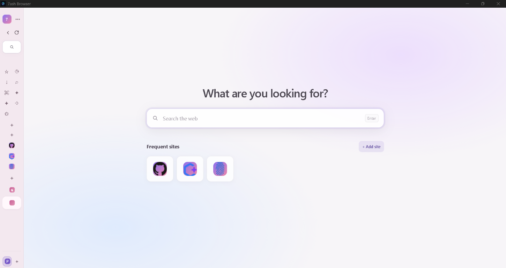
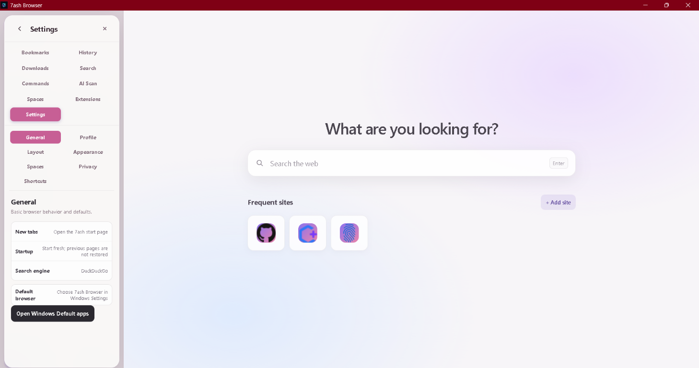
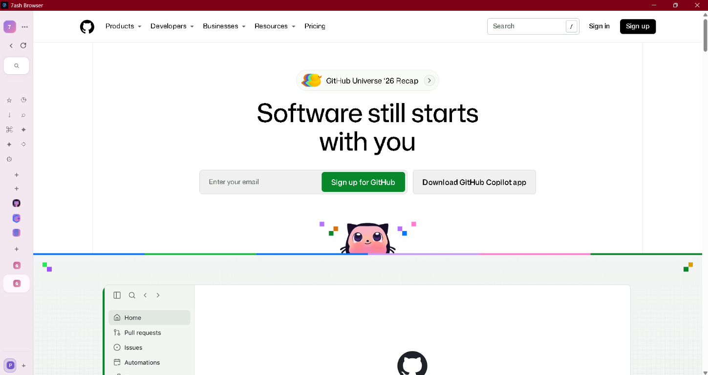

# 7ash Browser

<div align="center">

**A fast, private, and customizable desktop browser built with Electron.**

[Features](#features) · [Download](#download) · [Installation](#installation) · [Development](#development) · [Privacy](#privacy) · [Contributing](#contributing)

</div>

## Overview

7ash Browser is a Windows desktop browser with an Arc/Zen-inspired interface. It combines tab and workspace management, DuckDuckGo search, ad and tracker blocking, downloads, bookmarks, browser history, split views, local profile customization, Chrome extension loading, and optional Gemini-powered page analysis.

## Features

- **Workspace-based browsing** - Organize tabs into separate spaces.
- **Pinned tabs and split view** - Keep important pages available and view two tabs side by side.
- **DuckDuckGo search** - Search directly from the address bar or open the dedicated new-tab page.
- **Frequent sites** - Add custom shortcuts with names and local icons.
- **Bookmarks and history** - Save and revisit pages quickly.
- **Downloads panel** - Track download progress, state, and local save paths.
- **Ad and tracker blocking** - Uses Ghostery ad-blocking filters with a local cache.
- **Privacy controls** - Block common trackers, send DNT and Global Privacy Control signals, and clear browsing data.
- **Custom appearance** - Choose layouts, themes, accent colors, compact mode, animations, and local background images.
- **Local profile customization** - Set a profile name and avatar.
- **Extension support** - Load unpacked Chromium extensions and open the Chrome Web Store.
- **Gemini page scan** - Ask questions about the active page using an optional encrypted Gemini API key.
- **Windows integration** - Register 7ash Browser as an HTTP/HTTPS and HTML browser through the NSIS installer.

## Screenshots

### New tab



### Browser settings



### Split view



## Download

Download the latest Windows installer from the **Releases** page:

```text
https://github.com/7ashChandan/7ashBrowser/releases
```

The project currently produces `7ash Browser Setup 0.1.1.exe`.

## Installation

### Windows installer

1. Download the latest `.exe` installer.
2. Run the installer.
3. Choose the installation directory.
4. Launch **7ash Browser** from the Start menu or desktop shortcut.

### Windows from source

Requirements:

- Windows 10 or Windows 11
- Node.js 20 or newer
- npm

```powershell
git clone https://github.com/7ashChandan/7ashBrowser.git
cd 7ash-Browser
npm install
npm start
```

## Build

Create a distributable Windows NSIS installer:

```powershell
npm run dist
```

The installer and related build artifacts are written to `dist/`.

## Keyboard shortcuts

| Action | Shortcut |
| --- | --- |
| New tab | `Ctrl+T` |
| Command bar | `Ctrl+K` |
| Focus address bar | `Ctrl+L` |
| Bookmark page | `Ctrl+D` |
| Reload | `Ctrl+R` |
| Back | `Ctrl+[` |
| Forward | `Ctrl+]` |
| Switch spaces | `Ctrl+1` / `Ctrl+2` |

## Gemini page scan setup

The AI page scan is optional. It does not require a key until the feature is used.

1. Open **Gemini** or **AI Scan** in 7ash Browser.
2. Select **Set API key**.
3. Open the Gemini API key page and create a key.
4. Paste the key into 7ash Browser and save it.

The key is encrypted with Electron's `safeStorage` API and stored outside the project source under Electron's local application data directory. It is not committed to the repository.

API usage may incur provider charges and is subject to Google's terms and availability.

## Privacy

7ash Browser is designed to keep user-facing browser state local:

- Settings are stored in the user's Electron application-data directory.
- Bookmarks and frequent sites are stored locally.
- The Gemini API key is encrypted with OS-backed secure storage.
- Ad and tracker filter data is cached locally.
- Closing tabs does not send project data to external services.
- Clearing browsing data removes browser storage, cache, authentication cache, in-memory history, and downloads from the session.

Websites and optional integrations may still receive the network data normally sent while browsing.

## Project structure

```text
7ash/
├── main.js                    # Electron main process and browser behavior
├── preload.js                 # Secure browser UI bridge
├── 7ash-preload.js            # New-tab and DuckDuckGo integration
├── package.json               # Dependencies and electron-builder configuration
├── src/
│   ├── index.html             # Browser shell
│   ├── rendered.js            # Browser UI logic
│   ├── style.css              # Browser shell styles
│   ├── home.html              # New-tab page
│   ├── home.js                # New-tab page logic
│   ├── home.css               # New-tab page styles
│   ├── site-shortcuts.js      # Search and shortcut resolution
│   ├── 7ash.ico               # Windows application icon
│   └── windows-browser-registration.nsh
└── package-lock.json
```

## Contributing

Contributions are welcome.

1. Fork the repository.
2. Create a feature branch: `git checkout -b feature/my-change`.
3. Make focused changes and test them.
4. Commit the work with a clear message.
5. Push the branch and open a pull request.

Please open an issue for major features or behavior changes before implementation.

See [CONTRIBUTING.md](CONTRIBUTING.md) for setup and contribution guidance.

## Reporting issues

When reporting a problem, include:

- Windows version
- 7ash Browser version
- Steps to reproduce
- Expected behavior
- Actual behavior
- Screenshots or logs, when available
- Whether the issue occurs with a clean browser profile

Do not include API keys, personal data, passwords, cookies, or private URLs in issue reports.

## Security

Please report suspected vulnerabilities privately instead of opening a public issue. See [SECURITY.md](SECURITY.md).

Do not publish Gemini API keys or other credentials in source code or issue reports.

## License

Licensed under the MIT License. See [LICENSE](LICENSE).

## Disclaimer

7ash Browser is independent third-party software and is not affiliated with, endorsed by, or sponsored by DuckDuckGo, Google, Chromium, Electron, or Ghostery.
